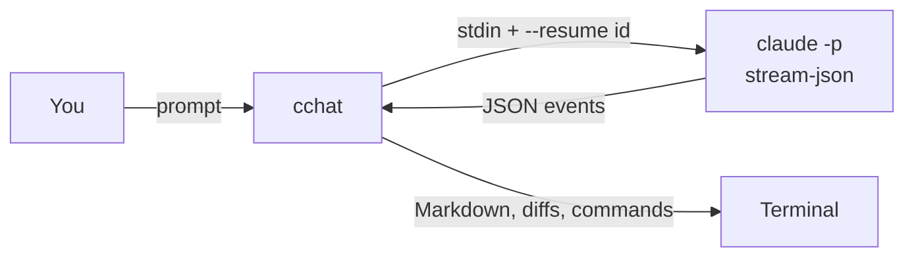

# cchat

Lightweight terminal chat for Claude, using your own API key or gateway.

## Design

cchat is a thin UI over Claude Code's headless mode. Each turn is one `claude -p` run, chained into a conversation by session id:



- **One process per turn.** `--resume <session_id>` links the turns, so there's no long-lived process to hang or crash. Claude can still edit files and run commands.
- **Credentials stay private.** The config becomes env vars for the child process only, plus a 0600 temp settings file. Nothing goes into argv or `~/.claude/settings.json`.
- **No config from the current directory.** A cloned repo can't redirect your key to another gateway.

## Run

```sh
git clone https://github.com/yusuke-114/cchat.git && cd cchat
./setup.sh        # installs uv and claude, links ~/.local/bin/cchat

# optional: your own key / gateway / model / MCP servers (see Configure)
mkdir -p ~/.config/cchat
cp cchat.config.example.json ~/.config/cchat/cchat.config.json
chmod 600 ~/.config/cchat/cchat.config.json
```

```sh
cchat                     # chat in the current directory
cchat "explain main.py"   # one-shot
cchat -r <session-id>     # resume
```

Type `/help` in a session for commands, or `cchat --help` for flags.

## Configure

cchat reads the first config it finds: `-c <path>`, then `~/.config/cchat/cchat.config.json`, then `cchat.config.json` next to `cchat.py`. Every field is optional. Without a config, `claude` uses its own login.

### Base URL and key

| Endpoint | Fields |
|---|---|
| Anthropic API | `api_key` |
| Gateway, Bearer auth | `base_url` + `auth_token` |
| Gateway, `x-api-key` auth | `base_url` + `api_key` |

`base_url` is the gateway root, without `/v1/messages`.

```json
{
  "base_url": "https://your-gateway.example.com",
  "auth_token": "your-token"
}
```

### Model

`model` is the default model. Use a full ID or an alias like `opus`. Override it per run with `-m`, or mid-session with `/model`.

If your gateway names models differently, map the aliases with `env`:

```json
{
  "model": "opus",
  "env": {
    "ANTHROPIC_DEFAULT_OPUS_MODEL": "your-gateway-opus-id",
    "ANTHROPIC_DEFAULT_SONNET_MODEL": "your-gateway-sonnet-id",
    "ANTHROPIC_DEFAULT_HAIKU_MODEL": "your-gateway-haiku-id"
  }
}
```

### MCP servers

`mcp_servers` uses the same format as Claude Code's `mcpServers`. It's passed with `--mcp-config`, so `~/.claude.json` isn't needed.

```json
{
  "mcp_servers": {
    "my-tool": { "command": "/absolute/path/to/server", "args": ["--stdio"], "env": { "TOKEN": "..." } },
    "docs": { "type": "http", "url": "https://mcp.example.com/mcp", "headers": { "Authorization": "Bearer ..." } }
  }
}
```

The startup banner lists the loaded servers.

### Other fields

| Field | Default | Flag |
|---|---|---|
| `effort` | claude's default | `-e`, `/effort` |
| `permission_mode` | `acceptEdits` | `--mode`, `/mode` |
| `allowed_tools` | `["Bash(git *)", "Bash(ls *)"]` | `--allow` (repeatable) |
| `setting_sources` | `project,local`; add `user` to load `~/.claude/settings.json` | `--setting-sources` |

Flags override the config. `env` passes any extra environment variables to `claude`.

## License

[MIT](LICENSE)
