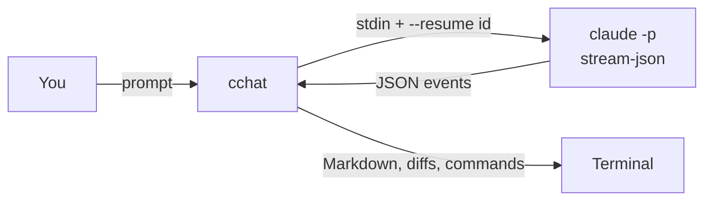

# cchat

Lightweight terminal chat for Claude, using your own API key or gateway.

## Design

cchat is a thin UI over Claude Code's headless mode. Each turn is one `claude -p` run, chained into a conversation by session id:



- **One process per turn.** `--resume <session_id>` links the turns, so there's no long-lived process to hang or crash. Claude can still edit files and run commands.
- **Credentials stay private.** The config becomes env vars for the child process only, plus a 0600 temp settings file. Nothing goes into argv or `~/.claude/settings.json`.
- **No config from the current directory.** A cloned repo can't redirect your key to another gateway.

## Run

```sh
git clone https://github.com/yusuke-114/cchat.git && cd cchat
./setup.sh        # installs uv and claude, links ~/.local/bin/cchat

# optional: your own key / gateway / MCP servers
mkdir -p ~/.config/cchat
cp cchat.config.example.json ~/.config/cchat/cchat.config.json
chmod 600 ~/.config/cchat/cchat.config.json
```

```sh
cchat                     # chat in the current directory
cchat "explain main.py"   # one-shot
cchat -r <session-id>     # resume
```

Type `/help` in a session for commands, or `cchat --help` for flags.

## License

[MIT](LICENSE)
